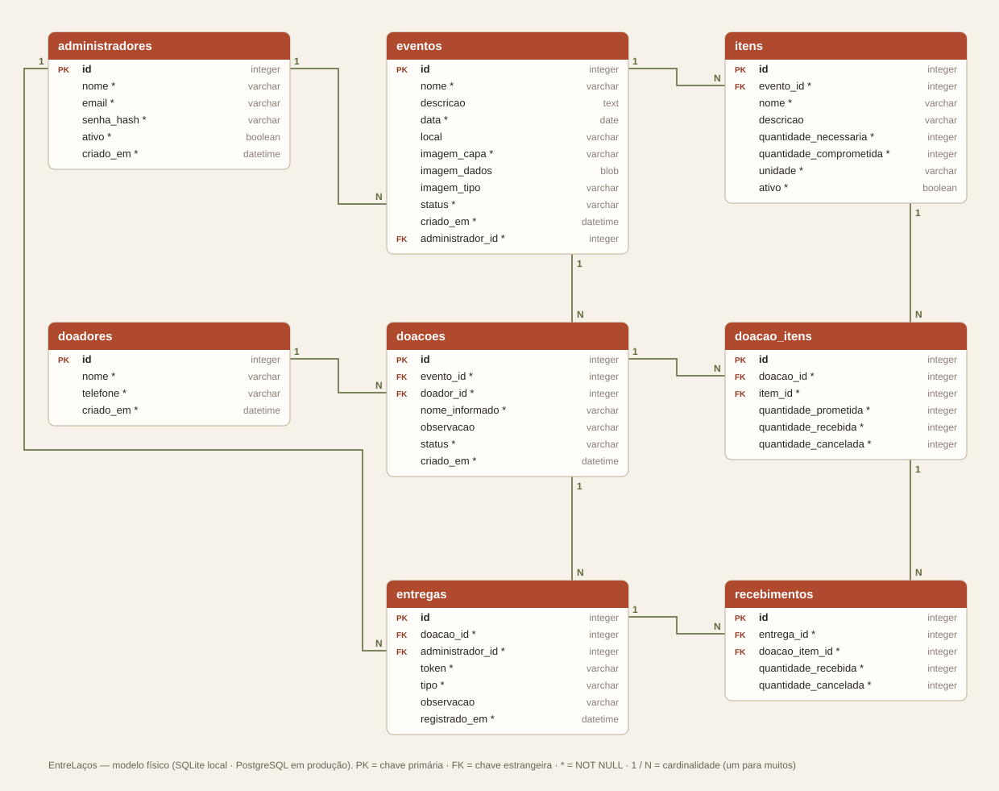

# EntreLaços — Documentação técnica

## 1. Identificação

- **Projeto:** EntreLaços — plataforma web para organização e gerenciamento de campanhas de doação
- **Integrantes:** _(preencher)_

## 2. Descrição do produto

**Objetivo.** Centralizar, em uma plataforma com banco de dados, a organização de eventos beneficentes: o que cada
evento precisa, quem se comprometeu a doar e o que já foi efetivamente entregue.

**Público-alvo.** Organizadores de eventos beneficentes e campanhas de arrecadação; igrejas, pastorais e grupos
religiosos; instituições e projetos sociais; grupos comunitários; e as pessoas que querem contribuir.

**Funcionalidades.**

| Visitante / doador (sem login) | Administrador (com login) |
|---|---|
| Ver eventos abertos e encerrados | Cadastrar e editar eventos com imagem de capa |
| Ver itens, quantidades prometidas e disponíveis | Cadastrar, editar e desativar itens |
| Montar carrinho de um evento | Consultar doações e dados dos doadores |
| Confirmar com nome, telefone e observação | Registrar recebimentos totais ou parciais |
| Consultar situação por nome ou telefone | Cancelar quantidades não entregues |
| | Acompanhar indicadores no painel |

## 3. Banco de dados

Modelo completo, com dicionário de dados e regras, em [`modelo_fisico.md`](modelo_fisico.md).
DDL gerada a partir dos modelos em [`schema.sql`](schema.sql) (SQLite) e [`schema_postgres.sql`](schema_postgres.sql) (PostgreSQL).



Resumo das entidades:

- **administradores** — organizadores; senha guardada como hash.
- **eventos** — nome, data, local, capa (imagem guardada no próprio banco) e status (`aberto`/`encerrado`).
- **itens** — necessidades de cada evento, com quantidade necessária e quantidade comprometida.
- **doadores** — identificados pelo telefone (só dígitos), sem conta.
- **doacoes** — uma por confirmação de carrinho; guarda a situação geral.
- **doacao_itens** — associativa entre doação e item, com prometido, recebido e cancelado.
- **entregas** — cada registro feito pelo organizador, com token único contra envio duplicado.
- **recebimentos** — quantidades recebidas/canceladas por item em cada entrega.

## 4. Código — trechos principais

### 4.1 Application Factory (`app/__init__.py`)

```python
def create_app(nome_config=None):
    nome_config = (nome_config or os.environ.get("FLASK_CONFIG")
                   or ("production" if os.environ.get("VERCEL") else "development"))
    app = Flask(__name__, static_folder="../public/static", static_url_path="/static")
    app.config.from_object(config_por_nome[nome_config])
    ...
    db.init_app(app)
    csrf.init_app(app)
    login_manager.init_app(app)

    _registrar_blueprints(app)
    _registrar_erros(app)
    ...
    return app
```

A mesma função cria a aplicação de desenvolvimento (`create_app()`) e a de testes (`create_app("testing")`),
mudando só a classe de configuração em `config.py`. Na Vercel (variável `VERCEL` presente) a configuração
de produção é escolhida automaticamente.

### 4.2 Registro dos Blueprints

```python
def _registrar_blueprints(app):
    app.register_blueprint(public_bp)
    app.register_blueprint(eventos_bp, url_prefix="/eventos")
    app.register_blueprint(doacoes_bp, url_prefix="/doacoes")
    app.register_blueprint(admin_bp, url_prefix="/admin")
```

### 4.3 Formulário com validação no servidor (`app/forms.py`)

```python
class ConfirmacaoDoacaoForm(FlaskForm):
    nome = StringField("Nome completo", validators=[
        DataRequired("Informe seu nome completo."), Length(min=5, max=150),
        validar_nome_completo,
    ])
    telefone = StringField("Telefone (com DDD)", validators=[
        DataRequired("Informe seu telefone."), validar_telefone,
    ])
    observacao = TextAreaField("Observação (opcional)", validators=[
        Optional(), Length(max=500, message="Use no máximo 500 caracteres."),
    ])
```

`validar_telefone` aceita números brasileiros com DDD (10 ou 11 dígitos, celular começando com 9).
Todos os formulários herdam de `FlaskForm`, que inclui o token CSRF.

### 4.4 Modelo `Doacao` e relacionamentos (`app/models.py`)

```python
class Doacao(db.Model):
    __tablename__ = "doacoes"
    id = db.Column(db.Integer, primary_key=True)
    evento_id = db.Column(db.Integer, db.ForeignKey("eventos.id", ondelete="RESTRICT"), nullable=False)
    doador_id = db.Column(db.Integer, db.ForeignKey("doadores.id", ondelete="RESTRICT"), nullable=False)
    status = db.Column(db.String(20), nullable=False, default=StatusDoacao.PENDENTE, index=True)

    evento = db.relationship("Evento", back_populates="doacoes")
    doador = db.relationship("Doador", back_populates="doacoes")
    itens = db.relationship("DoacaoItem", back_populates="doacao", cascade="all, delete-orphan")
    entregas = db.relationship("Entrega", back_populates="doacao")
```

### 4.5 Confirmação da doação em uma única transação (`app/services/doacoes.py`)

```python
for item_id, quantidade in itens.items():
    resultado = db.session.execute(
        update(Item)
        .where(
            Item.id == item_id,
            Item.ativo.is_(True),
            Item.quantidade_comprometida + quantidade <= Item.quantidade_necessaria,
        )
        .values(quantidade_comprometida=Item.quantidade_comprometida + quantidade)
    )
    if resultado.rowcount != 1:
        indisponiveis.append(...)

if indisponiveis:
    raise ErroNegocio("Alguns itens não têm mais a quantidade escolhida disponível ...")
...
db.session.commit()   # em qualquer erro: db.session.rollback()
```

A verificação e a reserva acontecem no mesmo comando `UPDATE`. Se duas pessoas tentam reservar o último
quilo ao mesmo tempo, só uma atualização passa na condição. Se qualquer item falhar, a transação inteira é
desfeita e o doador é levado de volta ao carrinho com a mensagem.

### 4.6 Recebimento parcial (`app/services/recebimentos.py`)

```python
if recebido + cancelado > doacao_item.quantidade_pendente:
    raise ErroNegocio("... ultrapassa o pendente ...")
...
doacao_item.quantidade_recebida += recebido
doacao_item.quantidade_cancelada += cancelado
if cancelado:
    item.quantidade_comprometida -= cancelado   # só o cancelamento libera quantidade
doacao.recalcular_status()
db.session.commit()
```

Cada envio do checklist carrega um `token` único (coluna `UNIQUE` em `entregas`): se o formulário for enviado
duas vezes, o segundo é recusado. O `CHECK` no banco (`recebida + cancelada <= prometida`) é uma segunda barreira.

### 4.7 Teste automatizado (`tests/test_admin.py`)

```python
def test_cancelar_quantidade_pendente_libera_para_novas_doacoes(client, login, evento):
    doacao = _doacao_de_5kg(client, evento)
    login()
    di = doacao.itens[0]
    _registrar(client, doacao, receber={di.id: 2})
    client.post(f"/admin/doacoes/{doacao.id}/cancelar", data={"token": uuid.uuid4().hex})

    assert di.quantidade_recebida == 2         # o recebido continua contabilizado
    assert di.quantidade_cancelada == 3
    assert arroz.quantidade_comprometida == 2  # apenas os 3 kg voltaram
```

**Resultado da execução (`pytest`):** 37 testes, 37 aprovados.

```
tests\test_admin.py .................                                    [ 45%]
tests\test_comandos.py ....                                              [ 56%]
tests\test_publico.py ................                                   [100%]
======================= 37 passed in 4.65s ========================
```

## 5. Arquitetura

```
Navegador ──► Blueprints (rotas) ──► Services (regras de negócio) ──► Models (ORM) ──► SQLite / PostgreSQL
                  │                          ▲
                  └── Forms (validação) ─────┘
                  └── Templates Jinja2 + Bootstrap
```

| Camada | Onde | Responsabilidade |
|---|---|---|
| Fábrica | `app/__init__.py`, `config.py`, `main.py` | Criar a aplicação, carregar configuração, iniciar extensões, logs e erros |
| Rotas | `app/blueprints/` | Receber a requisição, chamar formulário e serviço, devolver a página |
| Formulários | `app/forms.py` | Validar dados de entrada no servidor, CSRF |
| Regras de negócio | `app/services/` | Carrinho, transação da doação, recebimentos, dashboard, imagens |
| Persistência | `app/models.py` | Tabelas, relacionamentos e restrições |
| Interface | `app/templates/`, `public/static/` | HTML, CSS e JavaScript (na Vercel, `public/` é servida pela CDN) |

| Blueprint | Prefixo | Responsabilidade |
|---|---|---|
| `public` | `/` | Página inicial e “Como funciona” |
| `eventos` | `/eventos` | Página pública do evento; gerenciamento de eventos e itens (com login) |
| `doacoes` | `/doacoes` | Carrinho, confirmação e consulta pública |
| `admin` | `/admin` | Login, painel e gestão das doações |

As rotas não acessam regras de quantidade diretamente: chamam funções de `services/`, que levantam
`ErroNegocio` com mensagens prontas para o usuário. Isso permite testar as regras sem passar pela interface.

## 6. Tecnologias

| Tecnologia | Uso | Justificativa |
|---|---|---|
| Python 3 | Linguagem do backend | Legível e com bom ecossistema web |
| Flask | Framework web | Leve; permite organizar o projeto em fábrica e blueprints |
| SQLite | Banco de dados local | Arquivo único, sem servidor; ideal para desenvolver e testar |
| PostgreSQL (psycopg) | Banco de dados em produção | Na Vercel o disco não é permanente, então os dados ficam num Postgres (ex.: Neon) |
| Vercel | Hospedagem | Executa o Flask como função serverless e serve os arquivos estáticos pela CDN |
| SQLAlchemy / Flask-SQLAlchemy | ORM | Modelos em Python, relacionamentos, transações e consultas com agregação |
| Flask-WTF / WTForms | Formulários | Validação no servidor e CSRF integrados |
| Flask-Login | Sessão do administrador | Protege as rotas com `@login_required` |
| Jinja2 | Templates | Herança de layout e macros reaproveitáveis |
| Bootstrap 5 | Grid e componentes | Responsividade; personalizado com identidade própria em `style.css` |
| JavaScript | Interações | Seletor de quantidade, máscara de telefone, prévia da imagem |
| pytest | Testes | Fixtures com banco em memória isolado |
| python-dotenv | Variáveis de ambiente | Mantém a `SECRET_KEY` fora do código |

## 7. Execução

O passo a passo completo (local e na Vercel) está em [`COMO_RODAR.md`](COMO_RODAR.md). Resumo local:

1. Instalar o Python 3.11 ou mais recente.
2. Na pasta do projeto, criar e ativar o ambiente virtual:
   `python -m venv .venv` e `.venv\Scripts\activate` (Windows) ou `source .venv/bin/activate` (Linux/macOS).
3. Instalar as dependências: `pip install -r requirements.txt`.
4. Copiar `.env.example` para `.env` e definir uma `SECRET_KEY`
   (`python -c "import secrets; print(secrets.token_hex(32))"`).
5. Criar o administrador: `flask --app main criar-admin` (para trocar a senha depois: `flask --app main redefinir-senha`).
6. (Opcional) Cadastrar eventos de exemplo: `flask --app main popular`.
7. Iniciar: `flask --app main run` e acessar `http://127.0.0.1:5000`
   (área administrativa em `/admin/login`).
8. Rodar os testes: `pip install -r requirements-dev.txt` e depois `pytest`.

## 8. Desafios

_(preencher)_
