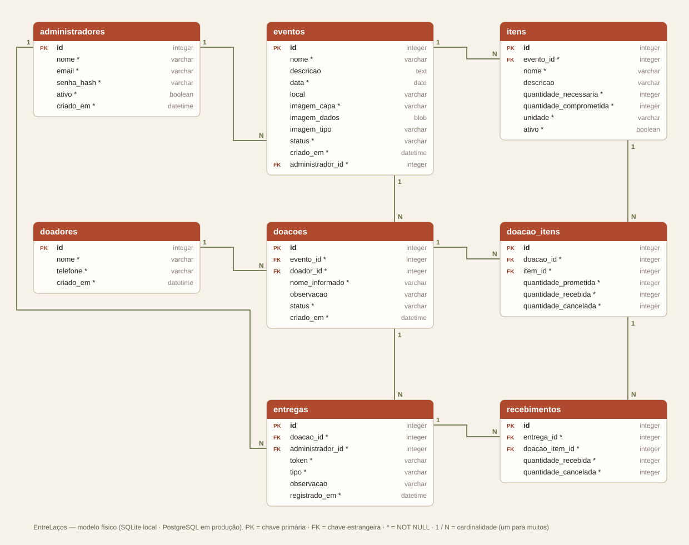

# EntreLaços — Modelo físico do banco de dados

Banco relacional **SQLite**, mapeado com **SQLAlchemy** (`app/models.py`).
O script completo de criação das tabelas está em [`schema.sql`](schema.sql), gerado a partir dos próprios modelos.

## Visão geral dos relacionamentos

| Relacionamento | Cardinalidade | Regra ao excluir o pai |
|---|---|---|
| administradores → eventos | 1 : N | RESTRICT |
| eventos → itens | 1 : N | CASCADE |
| eventos → doacoes | 1 : N | RESTRICT |
| doadores → doacoes | 1 : N | RESTRICT |
| doacoes → doacao_itens | 1 : N | CASCADE |
| itens → doacao_itens | 1 : N | RESTRICT |
| doacoes → entregas | 1 : N | CASCADE |
| administradores → entregas | 1 : N | RESTRICT |
| entregas → recebimentos | 1 : N | CASCADE |
| doacao_itens → recebimentos | 1 : N | CASCADE |

`doacao_itens` é a tabela associativa que resolve o relacionamento **N : N** entre `doacoes` e `itens`
(uma doação tem vários itens; um item recebe várias doações), guardando também as quantidades.

## Entidades

### administradores
Organizadores com acesso à área administrativa.

| Coluna | Tipo | Restrições | Descrição |
|---|---|---|---|
| id | INTEGER | PK | Identificador |
| nome | VARCHAR(120) | NOT NULL | Nome exibido no painel |
| email | VARCHAR(160) | NOT NULL, UNIQUE | Login |
| senha_hash | VARCHAR(256) | NOT NULL | Senha com hash (Werkzeug / scrypt). A senha em texto nunca é gravada |
| ativo | BOOLEAN | NOT NULL | Permite bloquear o acesso sem apagar o histórico |
| criado_em | DATETIME | NOT NULL | Data de cadastro |

### eventos
Eventos beneficentes que recebem doações.

| Coluna | Tipo | Restrições | Descrição |
|---|---|---|---|
| id | INTEGER | PK | |
| nome | VARCHAR(150) | NOT NULL | |
| descricao | TEXT | | Opcional |
| data | DATE | NOT NULL | Data de realização |
| local | VARCHAR(200) | | Opcional |
| imagem_capa | VARCHAR(255) | NOT NULL | Nome único da capa (usado na URL da imagem) |
| imagem_dados | BLOB / BYTEA | | Bytes da imagem (JPG, PNG ou WEBP, até 3 MB), carregados só quando a capa é pedida |
| imagem_tipo | VARCHAR(10) | | `jpg`, `png` ou `webp`, detectado pelo conteúdo do arquivo |
| status | VARCHAR(20) | NOT NULL, CHECK (`aberto`, `encerrado`), índice | Só eventos abertos aceitam doações |
| criado_em | DATETIME | NOT NULL | |
| administrador_id | INTEGER | FK → administradores.id, NOT NULL | Quem cadastrou |

### itens
Lista de necessidades de cada evento.

| Coluna | Tipo | Restrições | Descrição |
|---|---|---|---|
| id | INTEGER | PK | |
| evento_id | INTEGER | FK → eventos.id, NOT NULL, índice | |
| nome | VARCHAR(120) | NOT NULL, UNIQUE (evento_id, nome) | Não repete nome dentro do mesmo evento |
| descricao | VARCHAR(255) | | Ex.: “tipo 1”, “pacote de 5 kg” |
| quantidade_necessaria | INTEGER | NOT NULL, CHECK > 0 | Meta definida pelo organizador |
| quantidade_comprometida | INTEGER | NOT NULL, CHECK ≥ 0 e ≤ quantidade_necessaria | Total reservado por doações (inclui o já recebido, exclui o cancelado) |
| unidade | VARCHAR(30) | NOT NULL | kg, litros, pacotes… |
| ativo | BOOLEAN | NOT NULL | Desativar esconde o item sem perder as doações já feitas |

Quantidade disponível = `quantidade_necessaria − quantidade_comprometida` (calculada, não armazenada).

### doadores
Pessoas que confirmaram doações. Não há conta nem senha.

| Coluna | Tipo | Restrições | Descrição |
|---|---|---|---|
| id | INTEGER | PK | |
| nome | VARCHAR(150) | NOT NULL, índice | Último nome informado |
| telefone | VARCHAR(15) | NOT NULL, UNIQUE | Só dígitos com DDD (ex.: `27999991234`). Identifica o doador entre doações |
| criado_em | DATETIME | NOT NULL | |

### doacoes
Cada confirmação de carrinho gera uma doação.

| Coluna | Tipo | Restrições | Descrição |
|---|---|---|---|
| id | INTEGER | PK | Exibido como código `EL-00001` |
| evento_id | INTEGER | FK → eventos.id, NOT NULL, índice | O carrinho pertence a um único evento |
| doador_id | INTEGER | FK → doadores.id, NOT NULL, índice | |
| nome_informado | VARCHAR(150) | NOT NULL | Nome digitado naquela doação (usado na busca pública) |
| observacao | VARCHAR(500) | | Visível apenas para o organizador |
| status | VARCHAR(20) | NOT NULL, CHECK (`pendente`, `parcial`, `recebida`, `cancelada`), índice | Recalculado a cada movimentação |
| criado_em | DATETIME | NOT NULL | |

### doacao_itens
Itens e quantidades de cada doação, com o acompanhamento de entrega.

| Coluna | Tipo | Restrições | Descrição |
|---|---|---|---|
| id | INTEGER | PK | |
| doacao_id | INTEGER | FK → doacoes.id, NOT NULL | |
| item_id | INTEGER | FK → itens.id, NOT NULL | |
| quantidade_prometida | INTEGER | NOT NULL, CHECK > 0 | |
| quantidade_recebida | INTEGER | NOT NULL, CHECK ≥ 0 | Soma das entregas |
| quantidade_cancelada | INTEGER | NOT NULL, CHECK ≥ 0 | Soma dos cancelamentos |

Restrições adicionais: `UNIQUE (doacao_id, item_id)` e
`CHECK (quantidade_recebida + quantidade_cancelada <= quantidade_prometida)` — o próprio banco impede receber mais do que foi prometido.

### entregas
Cada vez que o organizador registra um recebimento ou cancelamento.

| Coluna | Tipo | Restrições | Descrição |
|---|---|---|---|
| id | INTEGER | PK | |
| doacao_id | INTEGER | FK → doacoes.id, NOT NULL | |
| administrador_id | INTEGER | FK → administradores.id, NOT NULL | Quem registrou |
| token | VARCHAR(36) | NOT NULL, UNIQUE | Gerado no formulário; impede gravar o mesmo envio duas vezes |
| tipo | VARCHAR(20) | NOT NULL | `recebimento` ou `cancelamento` |
| observacao | VARCHAR(255) | | |
| registrado_em | DATETIME | NOT NULL | |

### recebimentos
Detalhe de cada entrega, por item.

| Coluna | Tipo | Restrições | Descrição |
|---|---|---|---|
| id | INTEGER | PK | |
| entrega_id | INTEGER | FK → entregas.id, NOT NULL | |
| doacao_item_id | INTEGER | FK → doacao_itens.id, NOT NULL | |
| quantidade_recebida | INTEGER | NOT NULL, CHECK ≥ 0 | |
| quantidade_cancelada | INTEGER | NOT NULL, CHECK ≥ 0 | |

`CHECK (quantidade_recebida + quantidade_cancelada > 0)` evita linhas vazias.

## Regras de quantidade

| Momento | `itens.quantidade_comprometida` | `doacao_itens` |
|---|---|---|
| Doador confirma 5 kg | +5 (reserva) | prometida = 5 |
| Organizador recebe 2 kg | sem alteração | recebida = 2 |
| Organizador recebe 3 kg | sem alteração | recebida = 5 → status *recebida* |
| *ou* cancela os 3 kg restantes | −3 (libera) | cancelada = 3 → status *cancelada* |

## Situação da doação

Calculada pela função `calcular_status()` a partir dos totais de prometido, recebido e cancelado:

- **Pendente** — nada recebido e ainda há quantidade pendente.
- **Parcialmente recebida** — algo recebido e ainda há quantidade pendente.
- **Recebida** — tudo o que foi prometido foi recebido.
- **Cancelada** — não há mais pendência e parte (ou tudo) foi cancelada; o que já foi recebido continua contabilizado.

A mesma regra é aplicada a cada item (`DoacaoItem.status`), por isso a consulta pública mostra a situação item a item.

## Integridade no SQLite

O SQLite só aplica chaves estrangeiras com `PRAGMA foreign_keys=ON`. O projeto liga essa opção em toda conexão
(`app/__init__.py`, função `_ativar_chaves_estrangeiras`).
